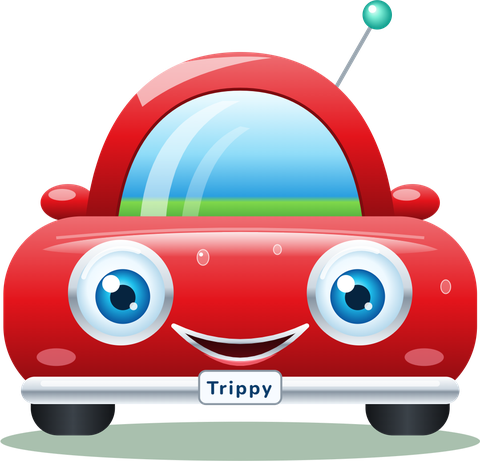

<p align="center">
  
</p>

<h1 align="center">Trippy</h1>

<p align="center">
  <b>The AI group leader for road trips, right inside iMessage.</b><br>
  Everyone answers in their own DM. Trippy votes only where you disagree, plans the trip around real people,<br>
  and hands everyone a live trip dashboard without leaving the conversation.
</p>

<p align="center">
  
  
  
  
  
</p>

<p align="center">
  
  
  
  
  
  
</p>

<p align="center">
  
  
  
</p>

## Highlights

- 💬 **Lives in iMessage:** each traveler texts Trippy in their own DM; first names come from Photon, and friends join with a forwarded code.
- 🗳️ **Votes only on disagreements:** reply with a number or in words; the OpenAI Decisions API maps free-text votes to options in ~200 ms.
- 🧭 **Plans while you vote:** the moment a poll opens, Gemini with Google Search starts drafting a complete itinerary for every possible outcome.
- 🧍 **Plans for people, not just places:** mealtimes, a stretch break every ~2 hours and at most ~8 hours of driving a day, all checked against real OSRM drive times.
- 📸 **Multimodal:** a photo becomes a wish while planning and a new stop on the road.
- 🗺️ **Live mini-app dashboard:** map, schedule, sustainability (fuel, CO₂, carpool savings) and group decisions, edited in place as plans change.
- ⏰ **Built on Tiger Data:** every message streams into TimescaleDB hypertables, which also drive the reminders.

See `CLAUDE.md` for the architecture, rules, and every deviation from the original pitch. The `dev/demo` branch tunes the flow for a 90-second live demo (see **Demo** below).

## Run it

1. **Prerequisites:** Node 24 and the [Photon](https://app.photon.codes) Spectrum project credentials. Every traveler's number must be added in the Photon dashboard, and every iPhone needs the Spectrum app.
2. Install and configure:
   ```sh
   npm install
   cp .env.example .env
   ```
   Then fill in `.env`:
   - `SPECTRUM_PROJECT_ID` and `SPECTRUM_PROJECT_SECRET`
   - `DATABASE_URL`: the Tiger Data (Tiger Cloud) Postgres connection string
   - `GEMINI_API_KEY` (and optionally `GEMINI_MODEL`, which must be a Gemini 3 model)
   - `PUBLIC_BASE_URL`: the public HTTPS URL from `ngrok http 8787` (`npm run demo:up` sets it for you)
   - `OPENAI_API_KEY`: optional, for the OpenAI Decisions API (faster vote mapping, wish sorting, send-off vibe). Without it, Gemini does those steps.
3. Check the setup:
   ```sh
   npm run llm:smoke   # Gemini key + model work (structured + Google Search)
   npm run db:migrate  # optional: boot also migrates
   ```
4. Start the agent and its tunnel:
   ```sh
   npm run demo:up     # Cloudflare quick tunnel (falls back to ngrok on PUBLIC_BASE_URL), then the agent
   ```
5. From iMessage:
   1. The host texts `new trip`, then forwards the `join CODE` bubble to friends.
   2. Each person sends `join CODE` to the agent (first names come from Photon).
   3. Everyone answers three questions and "anything else?".
   4. Everyone votes where answers differ.
   5. "✅ Itinerary ready!" arrives with the dashboard card, a send-off and a GIF.

   On the road, text changes like "we're running 30 min late".

**Try the dashboard without any keys:** `npm run dev:demo` serves a seeded trip that is clearly labeled **DEMO DATA**, using in-memory storage and real OSM routing.

> On the ngrok fallback, the card first opens ngrok's "You are about to visit…" page: tap **Visit Site** once per phone (ngrok remembers it for 7 days). The Cloudflare tunnel has no such page.

## Demo (90 seconds, two phones)

**Pre-flight**
- [ ] Both phones' numbers are added in the Photon dashboard **with a first name** (the agent greets people by it instead of asking).
- [ ] The GIF is at `DAP_GIF_PATH` (default `assets/dap.gif`), and `OPENAI_API_KEY` is in `.env`.
- [ ] `npm run demo:up` shows `demo_ready`. On the ngrok fallback, open any dashboard once on each phone and tap **Visit Site**.
- [ ] Do one full rehearsal on the same running process (it warms the geocode cache).

**Script** (Rameez = A, judge = B)

| | A (Rameez) | B (judge) |
|---|---|---|
| 1 | `new trip` → intro, `join CODE` bubble, "Hey Rameez! 📍 Where from, and where to?" | |
| 2 | Forward the `join CODE` bubble to B. | Send `join CODE` → "🎉 You're in Rameez's trip, Sam! 📍 Where to?" |
| 3 | `Chapel Hill to Wilmington` (the host sets the start for everyone) | `asheville` |
| 4 | `oct 18-19` | `Octobr 18 to 19` |
| 5 | `$300, halal` | `250, none` |
| 6 | `beach day` | `nope` |
| 7 | Vote **B's pick** ("your call!"). A tie means a revote, then an abort. | Vote by number or in words (`Asheville!`) |
| 8 | "✅ Itinerary ready!", the dashboard card, "🏔️ You're set for Asheville!…" and the dap GIF arrive on both phones. Go for the dap: *"So… are you ready for the trip?"* | |

## Develop

```sh
npm run typecheck && npm run lint && npm test
```

Tests run fully offline. They use in-process Postgres (PGlite) with the real migrations and scripted fakes for Gemini, geocoding, routing and chat.
